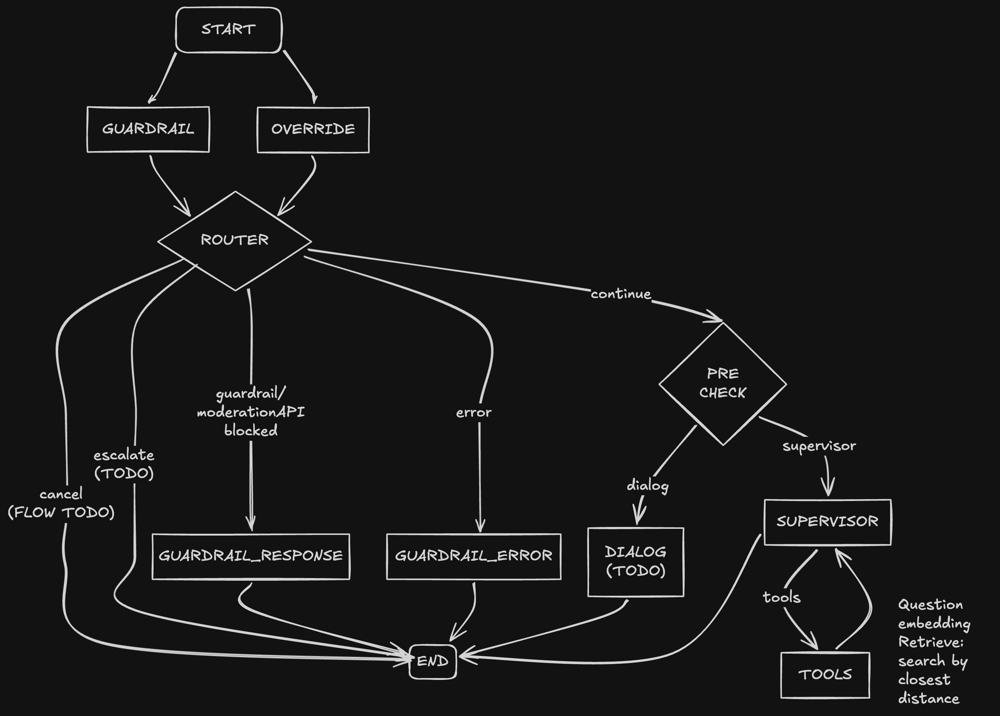

# Agent POC

check `issues` for implemented features and todos

## FINAL DEMO

FAQs datasource and PDF webpages datasource are embedded (check DB setup and ingest step) 
  - Main topic of the knowledge base is about RMIT Vietnam and RMIT scholarship

When user ask for factual information (RMIT Vietnam scholarship), pass to the supervisor then to a faq retrieval tool. From here, the question is embedded and search against the vector store (both faqs and webpages). Results are filtered for topK, normalized, then merged before passing back to the supervisor to generate the final answer.
  - There will be 2 llm request, first is for the model to select the tool, second is the main request with the context data from vector db so the model can answer the original user's question.

Questions about knowledge outside knowledge base (RMIT) will trigger a generic answer response.

Questions with harmful intents/prompt injections are denied and will trigger a generic answer (without calling to the supervisor to answer the question).


## Table of Contents
* [Project Objective](#objective)
* [Tech Stack](#tech-stack)
* [Project Structure](#project-structure)
* [Core Concepts](#core-concepts)
* [Setup](#setup)
* [State Graph](#state-graph-for-langgraph)
* [Milestones](#milestones)
* [AC](#acceptance-criteria)
* [Out of Scope](#out-of-scope)

## Objective

A chatbot assistant with LangGraph and LangChain. It supports three things:

1. **Info Q&A**: answer from public FAQ/help pages, with citations.
   - An ingestion mechanism to add new documents/FAQs to build the knowledge base for the LLM to answer factual questions
2. **Guardrail**:
   - Able to detect and deny malicious prompt injections from the users to protect the bot.
   - Able to detect uses' negative/harmful intents like harassment, violent, self-harm, etc.
3. **Dynamic dialog flows (optional for the final demo)**:
   - **Report an issue**: a multi-turn dialog that collects details, asks for confirmation, then creates a mock ticket.
   -  **Check status**: a dialog that extracts a case reference and queries a mock status API.


## Tech stack

TypeScript, Node.js, Express, LangGraph, LangChain, OpenAI (chat + `text-embedding-3-small`), PostgreSQL + pgvector (Docker), Vitest, and a CLI (curl) or minimal web page (use `./public/rag\ poc-documentation.html)

## Project structure

```
.
├── Dockerfile
├── README.md
├── compose.yaml                      # setup db container and main app container
├── datasource
│   ├── faq-scholarship-cs.json       # static FAQs to be ingest and embed
│   └── pdf                           # static web datasource to be ingest and embed
├── db
│   └── init.sql
├── dist                              # built folder
├── eslint.config.mjs
├── migrations                        # Prisma V8-styled migrations
│   ├── app
│   ├── pgvector
│   └── snapshots
├── package-lock.json
├── package.json
├── prisma.config.ts
├── public
│   └── graph_state.png
├── src
│   ├── chat                          # api layer
│   │   ├── app.ts
│   │   ├── middleware.ts
│   │   ├── routes.ts
│   │   └── session.ts
│   ├── config.ts
│   ├── domains                       # models
│   │   └── llm.ts
│   ├── graph                         # orchestration/llm state management layer
│   │   ├── dialogs
│   │   │   ├── checkStatus.ts
│   │   │   └── reportIssue.ts
│   │   ├── graph.ts
│   │   ├── nodes
│   │   │   ├── fallback.ts
│   │   │   ├── guardrail.ts
│   │   │   ├── guardrailClassifier.ts
│   │   │   ├── overrideDetector.ts
│   │   │   └── supervisor.ts
│   │   ├── routing.ts
│   │   └── state.ts
│   ├── index.ts                      # entry point 
│   ├── mocks                         # mock external api layer (TODO)
│   │   ├── statusService.ts
│   │   └── ticketService.ts
│   ├── prisma                        # prisma
│   │   ├── contract.d.ts
│   │   ├── contract.json
│   │   ├── contract.prisma
│   │   ├── db.ts
│   │   ├── pool.ts
│   │   └── queries.ts
│   ├── rag                           # input embedding, search by shortest distance
│   │   ├── indexing.ts
│   │   ├── ingest.ts
│   │   └── retriever.ts
│   └── utils
│       ├── annotation.ts
│       ├── constant.ts
│       ├── logger.ts
│       └── type.ts
└── tsconfig.json
```

## Core concepts

| Concept | Desc. |
|---|---|
| Retrieve tool call | Question embedding and retrieval is done via tool call |
| Supervisor with tool calling | An LLM picks one tool: `return_faq`(with citations), `start_dialog`(TODO), `fallback`, `escalate`(TODO). |
| Two knowledge types | Curated FAQ pairs are returned as written. Page chunks are used to generate an answer with citations. |
| Guardrail + override at START | Run both in parallel. A jailbreak attempt ends the turn. "Cancel" or "talk to a human" can interrupt any dialog. The guardrail fails closed: if it's unavailable, the turn ends with a friendly error. |
| Chat layer separate from AI layer | Express/session code stays separate from the graph module. |
| Fallback counter → escalation(TODO) | The 3rd fallback in a session hands over to a (mock) human agent. |
| Sticky dialogs (TODO) | A pre-check router keeps the user in the active dialog. If the dialog can't handle a message, control returns to retrieval. |

## Setup
Run the DB container
```
docker-compose up -d db
```
Run the main app
```
cd rag-learn
cp .env.example .env
```

Update these variables with your own creds. Note that Moderation API can only be used with OpenAI keys so OPENAI_API_KEY can be the same as OPENAI_MODERATION_API_KEY. If mixing providers like Grok and OpenAI, add Grok API key as OPENAI_API_KEY and OpenAI key as OPENAI_MODERATION_API_KEY
```
OPENAI_API_KEY=
OPENAI_MODEL=
OPENAI_BASE_URL=
OPENAI_MODERATION_API_KEY=
```
Run the app and query the chat API. Find the API in `public/rag poc-documentation.html`
```
npm run dev
```

### DB setup
PostGreSQL with vector extension + Prisma v8 + DBeaver

On initial setup, need to create the DB + tables. Workflow for prisma 8 has changed and need to create a 'contract' first prior to doing any migrations:

Initial setup (https://www.prisma.io/docs/orm/extensions/using-extensions?utm_source=chatgpt.com#5-apply-and-query):
- run db:generate:contract first to generate the contract
- run db:generate:plan to generate the initial migration
- run `npx prisma db init` to create the database, subsequent migration can use db:apply:migration

Confirm the scripts' outputs and tables exist in DBeaver

### Backfill vector db
Run the temporary ingestion script to process and embed static FAQs and static web datasource (in pdf form)
```
npm run ingest 
```

## State Graph for LangGraph

LangGraph as an orchestrator for chatbot's control flow and state. 



### State

```ts
{
  // messages between users/llm
  ...MessagesAnnotation.spec,
  // guardrail metadata
  guardrail: Annotation<GuardrailResult | undefined>({
    reducer: (_, update) => update,
    default: () => undefined,
  }),
  // llm latest response, for convenience sake
  response: Annotation<string | undefined>({
    reducer: (_, update) => update,
    default: () => undefined,
  }),
  override: Annotation<OverrideReason | undefined>({
    reducer: (_, update) => update,
    default: () => undefined,
  }),
  // current dialog flow
  activeDialog: Annotation<DialogName | undefined>({
    reducer: (_, update) => update,
    default: () => undefined,
  }),
  // metadata for the current dialog flow
  slots: Annotation<Record<string, unknown>>({
    reducer: (_, update) => update,
    default: () => ({}),
  }),
  awaitingConfirmation: Annotation<boolean>({
    reducer: (_, update) => update,
    default: () => false,
  }),
}
```

## Milestones 

| m | Focus |
|---|---|
| 1 | Setup, state, guardrail, override detector, pre-check router, supervisor skeleton |
| 2 | Ingestion and retrieval (FAQ + chunks), cited answers |
| 3 | Update docs, videos for the final demo 
| 4 | (optional) Report dialog (slot filling, confirmation, mock ticket) |
| 5 | (optional) Status dialog, fallback counter, escalation, switching topics mid-dialog |

## Acceptance criteria

- Setup is reproducible from the README.
- Logs contain routing decisions and reason codes, and no personal information.
- Retrieval runs in a tool bind to the supervisor
- FAQ matches are returned verbatim; generated answers carry valid citations.

- Jailbreak attempts are blocked; cancel and human overrides work from any state.
- If the guardrail is unavailable, the user gets a friendly error within 6 s and nothing else runs.
- For future work
  - Low or missing evidence leads to fallback; the 3rd fallback escalates.
  - An active dialog stays active across turns; off-topic messages are answered without losing dialog state.
  - A ticket is created only after explicit confirmation.
  - Status checks handle valid, invalid, unknown and error cases.

## Out of scope

Authentication, real agency integrations, streaming/SSE, multi-agent setups, live chat, production deployment, advanced retrieval (hybrid BM25, HyDE, fine-tuned rerankers).

